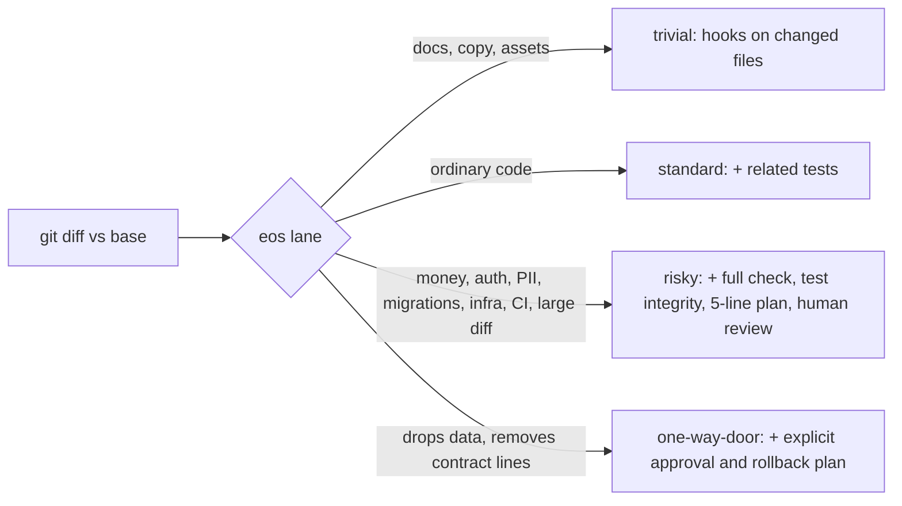
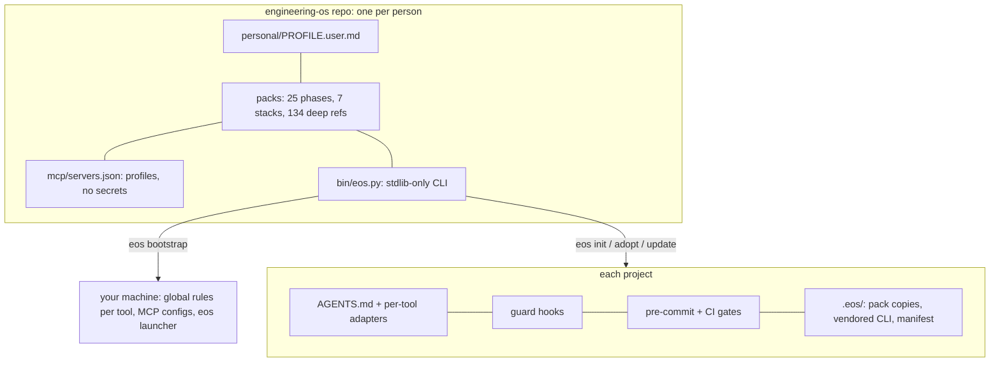

# engineering-os

[](https://github.com/fokou-winny-chanelle/engineering-os/actions/workflows/selftest.yml)
[](LICENSE)

**An engineering operating system for AI-assisted software work.** You clone one repo, run one command per machine and one per project. After that, every AI coding tool you use (Cursor, Cline, Claude Code, Codex and anything else that reads `AGENTS.md`) works to the same rules, checks and safety limits, whatever your stack.

## Why

AI agents write code fast. What they don't do on their own is:
- **stay consistent across tools.** Each tool has its own rules format, and they drift apart.
- **size the process to the risk.** A typo and a refund rule get the same treatment: too much ceremony for one, too little for the other.
- **know when to stop.** Without guardrails an agent may read your `.env`, force-push, loop on a failing test, or weaken a test to make it pass.
- **keep their context small.** Every rule you add costs tokens on every request.

engineering-os answers each with a mechanism, not a longer prompt:

| Problem | Mechanism |
|---|---|
| Drift between tools | One canonical set of packs, rendered into each tool's native format (`AGENTS.md`, `.cursor/rules`, `.clinerules`, `.claude/`, skills) |
| Same process for every change | **Lanes** computed from the diff: trivial, standard, risky, one-way-door. `eos verify` runs only what that lane needs |
| Unsafe agent actions | Guard hooks: secret files, force pushes, piping downloads into a shell, protected paths, loop detection, a stop check before "done" |
| Tests weakened to pass | `eos test-integrity` blocks new skips, removed asserts and lowered thresholds; CI checks coverage of the changed lines |
| Context bloat | Just-in-time loading: ~1.9k tokens at session start; deep references and stack rules load only for the files and tasks that need them |

## Quick start (about 2 minutes)

**Setting up a new PC from scratch, or not used to terminals?** Follow [docs/NEW-MACHINE.md](docs/NEW-MACHINE.md): one page, numbered steps from a blank machine to Cursor + Cline + eos working.

You need Git and Python 3.10+. `uv` and `pre-commit` are installed by the bootstrap script if missing.

**Windows** (PowerShell 5.1 or 7; paths with spaces are fine):
```powershell
git clone https://github.com/fokou-winny-chanelle/engineering-os "$HOME\engineering-os"
powershell -ExecutionPolicy Bypass -File "$HOME\engineering-os\bootstrap.ps1" --tools "cursor,cline"
notepad "$HOME\.config\engineering-os\secrets.env"     # optional tokens (MCP servers); never committed
# open a NEW terminal (bootstrap added %USERPROFILE%\.local\bin to your user PATH), then:
eos doctor
```

**macOS / Linux / WSL**:
```sh
git clone https://github.com/fokou-winny-chanelle/engineering-os ~/engineering-os
~/engineering-os/bootstrap.sh --tools cursor,cline     # or --tools all
$EDITOR ~/.config/engineering-os/secrets.env           # optional tokens; owner-only file, outside git
eos doctor                                             # every problem line ends with the fix
```

**In a project:**
```sh
cd my-project
eos start        # guided: new idea, existing code, rewrite, live product, or several repos
                 # (existing code -> `eos adopt`: never overwrites your files; new -> `eos init`)
git switch -c chore/engineering-os && git add -A && git commit -m "chore: add engineering-os"
```

Personal preferences (language, answer style, defaults) go in `personal/PROFILE.user.md`. That file is git-ignored and replaces the generic `personal/PROFILE.md` template. Run `eos bootstrap` again after editing it.

## The five commands you use every day

```sh
eos next              # the one next step, why, and the exact command or agent prompt
eos ship              # (the agent runs it) branch, commit, PR; autopilot merges it on green checks
eos autopilot setup   # once per repo: merge settings, labels, required check (eos explain autopilot)
eos verify            # the checks this change needs, sized to its lane (agents run it too)
eos lane              # trivial / standard / risky / one-way-door, why, and what that requires
eos spike try-redis   # throwaway branch: no tests or plans, guards still on, never merged
eos hotfix login-500  # urgent fix from main, reviewed afterwards
```

`eos stats` shows what eos itself costs you: hook latency, approval prompts, check durations.

## How lanes work



The lane comes from the paths and the content of the diff, not from the agent's opinion. CI computes it again and writes the files that need a human into the job summary. Overrides (`lane:<x>` label) are logged. Measured on a 61-module fixture: `eos verify` takes 0.4 s for a trivial change and 0.6 s for a standard one, and the guard hook adds about 40 ms per agent tool call ([evaluation](docs/research/v0.7.1-efficiency-evaluation.md)).

## Architecture



- **Layers:** personal profile (≤400 tokens, always on) → core rules (always on) → phase and stack packs (loaded by intent or file glob) → deep references (read only when a pack points to them).
- **Projects are self-contained:** `.eos/bin/eos.py` is vendored, so hooks and CI work without this repo installed. `eos update` refreshes managed files only where you haven't edited them; where you have, it writes `.eos-new` next to the file for you to merge.
- **Any project state and shape:** greenfield, existing code (ratchet gates: old violations are recorded as a baseline, only new ones block), rewrite (strangler fig, parity, cutover), live product; single app, monorepo, modular monolith, microservices, multi-repo workspace.

## The deep library

134 expert references across 12 areas: architecture, security, data, API, testing, operations, frontend, design, mobile, LLM applications, analytics and ML. Each is dated, sourced and capped at about 2.5k tokens. They are **never** always-on: a pack points an agent to one when it does that work. Where a machine can check a practice, it became a gate (`eos verify` extras, Semgrep rules, CI steps) or an opt-in scaffold (`eos scaffold list`, 33 kinds). Details: [docs/LIBRARY.md](docs/LIBRARY.md), [docs/LIBRARY-STATUS.md](docs/LIBRARY-STATUS.md).

Some references carry defaults for French/English products in Central Africa (XAF formatting, `Africa/Douala` time zone, mobile money). They are examples you can replace.

## Safety model

- **Secrets never touch git.** They live in `~/.config/engineering-os/secrets.env` (owner-only). Client configs reference them by name (`${env:VAR}` in Cursor, `${VAR}` in Claude Code, variable names in Codex). Cline is the exception: it needs literal values, which go only into its private settings file.
- **Agents are blocked** from reading `.env*` and key files, bypassing hooks, force-pushing and piping downloads into a shell. Deploys, migrations, infra changes, publishing and database clients need your approval.
- **MCP servers are least-privilege by default:** the default profile is Context7 only. The GitHub server is read-only. The Postgres server is read-only and local-only (four layers: host allow-list, forced read-only session, a read-only database role, upstream restricted mode). The browser server is limited to localhost, headless, with an isolated profile. See [mcp/README.md](mcp/README.md).
- **Hooks are defence in depth.** They do not replace branch protection, CODEOWNERS, least-privilege tokens or human review. Money, auth, crypto, migrations and infra always need a human reviewer.

## Status and limitations

engineering-os is **pre-1.0 (v0.7.1)** and maintained by one person. Expect changes between minor versions; `eos update` handles them without overwriting your edits.

- **Windows:** the bootstrap, CLI, hooks for Cursor and Claude Code, and MCP launchers support native Windows. Cline hooks are macOS/Linux only. The Flutter stack's pre-commit hooks need `bash` (Git Bash) on PATH. The Windows CI job is non-blocking until it has a track record.
- **Vendored third-party packs** (`packs/vendor/`, 8 sources) are quarantined pending human review. They keep their own licences ([THIRD_PARTY_NOTICES.md](THIRD_PARTY_NOTICES.md)) and are not loaded into agent context until reviewed.
- **Legal content** (data-protection law summaries, credit-scoring rules) is engineering guidance, not legal advice.
- **Numbers:** latency and token figures come from the benchmark scripts in `tests/bench/` on one Linux machine. Estimates are labelled as estimates.

## Documentation

| Doc | What it covers |
|---|---|
| [docs/GUIDE.md](docs/GUIDE.md) | Start here: the principles in plain language |
| [docs/WORKFLOW.md](docs/WORKFLOW.md) | Day-to-day flow from idea to release |
| [docs/REFERENCE.md](docs/REFERENCE.md) | Every command, every file eos writes, repo layout, versioning |
| [docs/LIBRARY.md](docs/LIBRARY.md) | How the deep library is organised and loaded |
| [docs/BLUEPRINT.md](docs/BLUEPRINT.md) | The full design rationale with sources |
| [docs/PROFILES.md](docs/PROFILES.md) · [docs/ARCHITECTURE.md](docs/ARCHITECTURE.md) · [docs/bootstrap.md](docs/bootstrap.md) | Project profiles, internals, machine setup details |
| [mcp/README.md](mcp/README.md) | MCP profiles, measured token costs, guarded servers |
| [CHANGELOG.md](CHANGELOG.md) | What changed in each version |

## Contributing, security, licence

- Contributions are welcome: see [CONTRIBUTING.md](CONTRIBUTING.md) and the [Code of Conduct](CODE_OF_CONDUCT.md).
- Found a vulnerability? Please report it privately: [SECURITY.md](SECURITY.md).
- **Licence:** MIT ([LICENSE](LICENSE)). Vendored directories under `packs/vendor/` keep their own licences (CC BY-SA 4.0, Apache-2.0, MIT), and the API references adapted from CC BY 4.0 guidelines keep their attribution sections: see [THIRD_PARTY_NOTICES.md](THIRD_PARTY_NOTICES.md).
